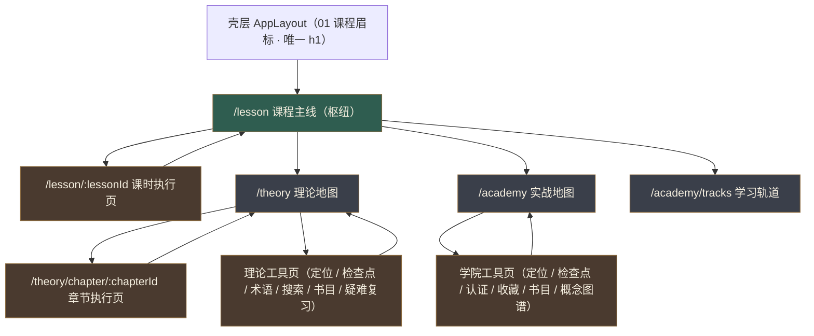
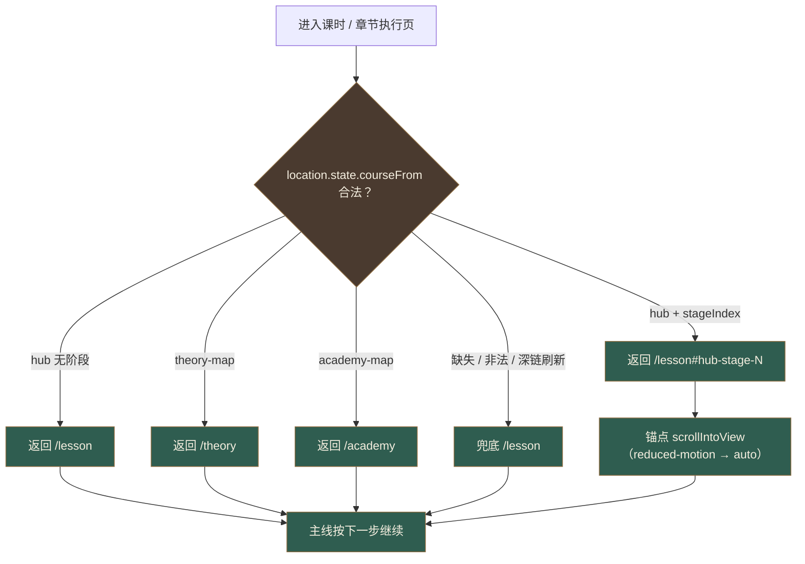

# 课程区信息架构与学习基线（COURSE_IA）

状态：Current

> 范围：`/lesson` 课程主线、`/theory` 理论地图、`/academy` 实战地图及其执行页 / 工具页的角色、返回语义与数据边界。
> 本文只写角色、规则与不变量；数量（课时 / 章节 / 路由条数）、阈值与 persist 版本一律以代码与守卫为唯一事实源，本文不复写数值。

---

## 1. 教育目的

| 维度 | 结论 |
|---|---|
| 主线 | `/lesson` 是课程区唯一主线（枢纽 = 定位条 + 下一步卡 + 双泳道阶段路径 + 掌握度 + 目录入口）。学习者的「现在该做什么」只由主线回答 |
| 双泳道 | 理论构建（概念）与实战应用（执行）并列但不混同：概念泳道回答「为什么」，实战泳道回答「怎么打」 |
| 认证归属 | 能力凭证只由实战侧承担（策略 Level 认证）；理论侧只有检查点与复习，不发证书、不解锁下一级 |

设计后果：地图是「看全局」的浏览面，不是第二主线；任何地图根都必须能回到主线，且不能替代主线的下一步语义。

---

## 2. 课程资产学习逻辑

链条：**阶段 → 课时 / 章节 → 概念锚点 → 掌握度 / SRS**。

- **阶段**：策略侧 `learningStages.ts` 按 Level 序列与先修生成阶段快照；阶段的 `theoryChapterIds` 由课时声明的理论锚点投影而成（去重保序，短牌可为空）。归并、状态与「下一课」的纯函数在 `shared/utils/academyJourneyGroups.ts` / `academyJourneyProgress.ts`，progress 与 strategy 共用同一份判定。
- **课时 / 章节**：课时（含 Drill 型）与理论章节是两种执行载体；课时 id 与理论章节 id 分属不同命名空间，跨院只传 id / 路由字符串。枢纽只做投影：不新增 store / registry，不改 persist。
- **概念锚点**：课时数据层声明锚点，理论章按锚点归入阶段；没有锚点的章节进入折叠「补充阅读」。短牌缺锚点时显示「概念关联待补充」，不伪造映射。
- **掌握度 / SRS**：首次成绩判定 `resolveFirstScore` 与理论复习项判定 `isTheoryReviewItem` 是单一事实源；掌握度派生（`summarizeMastery` / 阈值）位于 `strategy-academy/utils/academyMastery.ts`（枢纽投影两院掌握，单消费回迁），题级复习以 `shared/utils/academySrs.ts` 为准，模块内不得另写第二套阈值或判定。

---

## 3. 评估分层

| 层级 | 载体 | 计分影响 | 是否能力凭证 |
|---|---|---|---|
| 形成性 | 课时测验、课后 Drill、理论章末小测、Level Checkpoint | 首考计 ELO 与掌握度；重考只更新 best / last 并进 SRS | 否 |
| 终结性 | 策略 Level 认证（仅标准变体） | 首考计 ELO；通过即解锁下一级 | 是（唯一凭证出口） |
| 诊断性 | 策略定位测评、理论定位 | 只放宽解锁（写 `creditLevels`），不写完成态、不计 ELO / 掌握度 / SRS | 否 |

口径统一为「首考定能力、重考定复习」：重考不得重复累加 ELO；错题按题级进入 SRS 并能回跳所属课时 / 章节。

---

## 4. 信息架构

角色约束：`/lesson` 横向承接两张地图与轨道（主线唯一）；地图根纵向只接自己的子路由；执行页与工具页各自只回所属上级。

---

## 5. UI 操作规则（R1–R10）

| 规则 | 内容 | 事实源 / 守卫 |
|---|---|---|
| **R1 来源感知返回** | 执行页返回目标由进入来源决定：主线来源回 `/lesson`（携带阶段序号时回 `/lesson#hub-stage-N`），理论地图来源回 `/theory`，实战地图来源回 `/academy`；深链 / 刷新 / 非法 state 一律兜底 `/lesson` | `shared/utils/courseBack.ts`（`hubFrom` / `theoryMapFrom` / `academyMapFrom` / `resolveCourseBack`） |
| **R2 工具页回地图** | 地图下的工具页（定位、检查点、认证、收藏、书目、术语、搜索、疑难复习、概念图谱）返回所属地图，不落回主题线 | 两院工具页 `nav.backToTheoryMap` / `nav.backToAcademyMap` |
| **R3 地图根回主线** | 两张地图的根页只提供「返回课程目录」→ `/lesson`；地图根不承担「下一步」语义 | `nav.backToCourseHub` + 两院地图根头 |
| **R4 锚点回位** | 主线来源返回时按 `#hub-stage-N` 回位阶段卡；`scrollIntoView` 尊重 `prefers-reduced-motion`（降级为 `auto`），短延迟等待阶段卡挂载 | `CourseHub` 的 hash 效应；阶段卡 `id=hub-stage-N` / `data-hub-stage` |
| **R5 变体 canonical 在主线** | 变体（标准 / 短牌 / 单挑）的唯一 canonical 切换点在课程主线；地图与执行页只读当前变体，不各自持久化第二份选择。批次 2 落地：主线经 `TheoryDataSource.switchVariant` 发出唯一切换命令，地图只读显示 | `shared/types/theoryDataSource.ts`（`getActiveVariant` / `switchVariant`）+ `CourseHub` |
| **R6 前进带 state** | 枢纽 → 执行页的前进链接必须携带来源 state（`courseFrom`），执行页不靠 referrer 猜来源 | `courseBack` 的 `COURSE_FROM_KEY`；阶段卡 chip |
| **R7 显式返回** | 课程区的返回一律是显式控件（回到确定目标），不依赖浏览器返回键；浏览器返回键仅作为额外通路 | `BackLink` |
| **R8 返回入口单源** | 返回入口只用 `shared/components/layout/BackLink`（`to` / `onClick` / `historyBack` 三选一，文本 / 胶囊 / 按钮三变体）；icon-only 必填 `aria-label`；触摸目标 ≥44px | `BackLink.tsx` + DESIGN §13.7 |
| **R9 地图角色文案** | 两张地图在导航、页名、目录入口中统一称「实战地图」「理论地图」，不复用「学院」作为地图名 | `nav.academy` / `nav.theory`（core nav 单源文案） |
| **R10 课程激活覆盖 01 组** | 导航「课程」项指向主线，但 `/lesson`、`/academy`、`/theory` 三个前缀都点亮该项：桌面侧栏与移动底栏共用同一判定（`isCourseSectionPath`），其他导航项仍按自身前缀判定 | `src/layouts/navSections.ts`（`COURSE_SECTION_PREFIXES` / `isCourseSectionPath`）+ `AppLayout` / `MobileNav` |

补充：R10 的跨地图激活是**视觉态**；当前页身份由壳层 h1、01 眉标与路由播报承担（`NavLink` 自身的 `aria-current` 仍只覆盖 `/lesson` 子树），不做伪 `aria-current`。

---

## 6. 数据边界

- **两院 store 不合并**：策略与理论各自持有 store / persist；课程区只做跨院只读投影，不新增第二套状态。
- **单一变体切换命令**：变体上下文由 `TheoryDataSource` 可选 `getActiveVariant` / `switchVariant` 承载，课程主线是唯一命令发出方；切换复用两院既有 action / 字段，地图与执行页只读，不新增 store、不写第二份 persist 字段。
- **理论经 registry**：策略与中枢侧只经 `shared/stores/theoryDataSourceRegistry` 读理论快照 / 目录，禁止 `progress` import 理论模块。
- **persist 不变**：课程 IA 只读与路由语义调整，不改两院 store 的 schema / version / migrate。
- **进度只经公共入口**：课程区读进度走 progress 公共入口（`api` / `ui` / 只读快照 hook），禁止深引模块内部。

---

## 7. 端到端旅程（返回判定）

旅程验收：`shared/utils/courseBack.test.ts`（解析分支）、`AppLayout.test.tsx`（页名 / 展宽 / 课程激活）、`e2e/lesson-hub.test.ts`（枢纽 → 课时 → 返回目录并回位）与 `e2e/ia-navigation.test.ts`（地图页名 + 地图根回主线）、`e2e/ia-restored.test.ts`（工具页回所属地图）。

---

## 8. 覆盖报告与评估区（批次 3）

- **枢纽覆盖报告（只读）**：`CourseCoverageCard` 汇总理论章节与实战课时的双向映射（已关联实战章 / 补充阅读章 / 有理论锚点的课时），数据来自 `hubStages` 与 `lessonMeta.theoryAnchors`；只展示，不门禁、不写进度。
- **地图评估区（只读聚合）**：`/academy` 的「评估」区集中检查点 / 认证 / 定位；`/theory` 的「评估」区集中定位 / 检查点（理论不发证书）。评估行为与门禁不变，仅收敛入口。
- **去重**：两张地图不再重复主线/首页的续学 Hero 与每日计划；续学归 `/lesson`，每日计划归首页。

## 9. 学习闭环化与地图瘦身（批次 4，2026-11-23）

> 只改呈现层；§1 教育目的、§4 角色、§5 规则 R1–R10、§6 数据边界均不变。

- **阶段卡闭环**：每段按 `01 概念 → 02 实战 → 03 自查` 呈现；步骤③仅标准变体显示，链接 `/academy#assessment`（评估区锚点）。不直链检查点页：工具页按 R2 回地图会打断「回主线」闭环，评估区聚合入口 + 地图根 R3 回主线使闭环闭合。非标准变体呈两步闭环。
- **双泳道进度**：阶段头部并列理论 / 实战两个迷你进度环，理论未就绪或短牌无锚点时占位不伪造；阶段 `complete` 与解锁仍由实战完成态驱动（`computeStageStates` 不变）。
- **课时级配对**：实战 chip 展示首个理论锚点章标题（`lessonMeta.theoryAnchors[0]`）；Drill / 无锚点降级不显示。
- **地图瘦身**：掌握度单源为枢纽 `CourseMasteryDualCard`（含最弱项导航）；实战学习工具与理论阅读统计默认折叠（原生 `details`，理论统计 `flaggedQuestions > 0` 自动展开）；地图保留「阶梯 + 检索 + 评估」主干。
- **单一事实源回迁**：`academyMastery`（掌握度派生）因单消费回迁 `strategy-academy/utils/`（准入守卫强制）；理论复习判定仍以 `shared/utils/academySrs.ts` 为准。