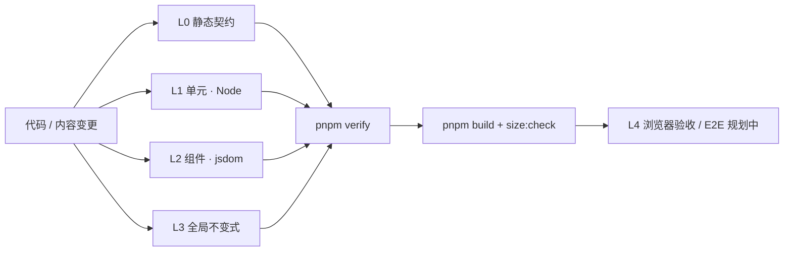

# 测试体系规范（TESTING）

> 地位：本文件是测试**分层、文件放置与命名、判定标准、执行矩阵、责任与评审**的唯一事实源。
> 不重复维护的事实：运行命令以 `package.json` 为事实源；CI 步骤以 `.github/workflows/*.yml` 为事实源；全局守卫清单以 [`src/guards/README.md`](../../src/guards/README.md) 为事实源；测试文件清单以 `src/**/*.test.ts(x)` 实际文件为准。
> 变更本规范时同步：`AGENTS.md` §质量门禁、`docs/TDD.md` §11、`docs/agents/README.md`。

---

## 1. 目标与原则

测试只回答一个问题：**这次改动破坏了哪个契约？** 本项目的契约优先级：

1. 数值与策略正确（赔率 / EV / 组合数 / 范围频率 / ICM）
2. 状态可迁移（persist schema、IndexedDB、复习队列）
3. 模块边界不破（依赖方向 / 公共 API）
4. 内容不漂移（课程 / 题库 / 双语 / 术语 / 位置方向）
5. 用户路径可回归（渲染 / 交互 / 可访问性）

原则：

- **风险驱动**：按契约失效的后果分配测试，不追求全仓行覆盖率数字。
- **确定性**：时间、随机、存储、网络、i18n 加载必须可控；同输入同结果。
- **回归锁**：每个缺陷修复必须附一个在修复前会失败的测试；每个数据 / 内容修正必须附完整性守卫。
- **单源**：断言代码契约，不复制实现；测试数据从源数据导入，不手写第二份。
- **快速反馈**：本地按层跑，CI 全量跑；失败信息必须能定位到文件与契约。
- **诚实性**：没有 EV 标定的选项不得断言 / 呈现五级反馈；没有真实数据的策略不得用测试“补”出来。

## 2. 分层模型

| 层 | 名称 | 环境 | 判定对象 | 入口 | 阻断位置 |
|---|---|---|---|---|---|
| L0 | 静态契约 | Node | 类型、Lint（模块边界 / any）、仓库卫生、生成物漂移 | `pnpm verify` 前四步 | 本地 verify / PR CI / main CI |
| L1 | 单元 | Node | 纯函数、store action、parser、迁移、排序、公式 | `pnpm test:unit` | 同上 |
| L2 | 组件 | jsdom | 渲染、交互、键盘、a11y、双语真实文案 | `pnpm test:component` | 同上 |
| L3 | 全局不变式 | Node（少数 jsdom） | 跨模块快照、i18n 对称、课程 / 题库完整性、设计 token、行数棘轮 | `pnpm test:guards` / `pnpm test` | 同上 |
| L4 | 浏览器验收 | 真实浏览器 | 关键用户路径、视觉 / 响应式、跨页状态 | 手工（`pnpm dev` + 浏览器） | PR 评审证据（E2E 落地前） |
| R | 发布 | Node + Vite | 生产构建、首屏体积 | `pnpm build && pnpm size:check` | main CI / 发布 |

E2E 尚未落地（见 §11），因此 L4 目前是**人工门禁**：UI / 路由 / 样式变更必须在真实浏览器走完黄金路径与至少一个边界场景，并在 PR 描述记录“已验证 / 未验证 + 原因”。

> PR CI 的阻断力依赖仓库分支保护：需把 `CI` workflow 设为 required check；workflow 本身只负责执行与报告。

## 3. 文件放置与命名

### 3.1 后缀与项目

| 后缀 | 项目 | 环境 | 用途 |
|---|---|---|---|
| `*.test.ts` | unit | Node | 纯函数、store、parser、迁移、数据完整性、全局守卫 |
| `*.test.tsx` | component | jsdom | 组件渲染 / 交互 / a11y |
| `*.a11y.test.tsx` | component | jsdom | axe 扫描；必须用 `src/test-utils/a11y.ts` harness |
| `*.migrate.test.ts` | unit | Node | persist `migrate` 链；需 stub `window.localStorage` |
| `*.persist-shape.test.ts` | unit | Node | persist 输出形状 / 版本 / 字段白名单 |
| `*.integrity.test.ts` | unit | Node | 课程、题库、引用、ID 唯一性等数据完整性 |
| `*.parity.test.ts` | unit | Node | 摘要 / 生成物与源数据一致 |
| `*.guard.test.ts` | unit | Node | 全局或模块级不变式；全局放 `src/guards/` |

> 既有测试保留原名（如 `curriculumIntegrity.test.ts` / `*optionOrder.test.ts`）；新增测试按上表后缀选择。既有守卫保留原名（`*Guard.test.ts` / 描述性命名）；新增守卫统一使用 `*.guard.test.ts`。无论文件名如何，新增守卫都必须登记 `src/guards/README.md`。
>
> 含 `describe(` / `it(` 声明的源码必须使用 `.test.ts(x)` 后缀；`testSystem.guard.test.ts` 会扫描并阻断不会被收集的“伪测试文件”。

禁止 `.spec.ts(x)` 与 `__tests__/` 目录；两者不会被 Vitest 双项目收集，属于静默失效，由 `testSystem.guard.test.ts` 阻断。

### 3.2 放置

- 单元测试与源码同目录（colocate），文件名 = 被测文件 + `.test.ts`；一个文件可覆盖多个相邻纯函数，但必须有清晰 `describe`。
- 组件测试与被测组件同目录；页面级组合测试放模块 `components/` 下。
- 全局不变式放 `src/guards/`；i18n 全局守卫放 `src/i18n/`；模块级数据完整性留在模块内。判定标准：**跨模块或全仓契约 → `src/guards/`；单模块契约 → 模块内**。
- 新增全局守卫必须同步 `src/guards/README.md` 清单；`testSystem.guard.test.ts` 会校验“文件 ↔ 清单”双向一致。
- 测试辅助代码放 `src/test-utils/`（不进运行时 bundle）或模块内测试工具文件；禁止测试文件之间直接 import 业务测试。

### 3.3 命名

- `describe` 写被测契约 / 场景，`it` 写“行为 + 预期”，使用中文，与现有测试一致。
- 避免 `it('works')` / `it('test 1')`；名称必须能直接说明失败含义。
- 一个 `it` 只表达一个断言主题；允许同一主题下多断言，但不得把互不相关的契约塞进一个超大用例。

## 4. 按变更类型的最小测试要求

> “最小”指必须覆盖的契约，不是数量上限。新增行为优先在最低能复现问题的层加测试。

| 变更类型 | 必测层 | 必须覆盖 |
|---|---|---|
| 纯函数 / 公式 / 赔率 / EV / 组合数 | L1 | 正常值、边界、退化输入、与单一事实源的一致性；浮点用 `toBeCloseTo` |
| store action / 选择器 | L1 | 初始形状、状态转移、幂等性（“记录完成”同日不重复）、跨模块副作用 |
| persist schema / version | L1 | 旧版本 → 新版本迁移链、未知字段、损坏数据兜底、`<store>.persist-shape.test.ts` 形状锁 |
| parser / 导入器 | L1 | 合法样本、非法 / 截断输入、格式检测、金额与牌面口径 |
| 组件交互 | L2 | 用户可见行为、键盘 / 焦点、禁用 / 加载 / 错误态、真实 zh 文案 |
| 可访问性 | L2 | `expectNoA11yViolations`；豁免必须逐条带 `reason` |
| 课程 / 题库 / 理论内容 | L1 完整性 | ID 唯一、引用无悬空、章节结构、题量、选项排序分布、EV 标定诚实性、zh/en 对齐 |
| 选项排序 | L1 | 正确答案索引分布守卫；同一天每日题同题同序 |
| 跨模块契约 | L3 | 快照 / 一致性断言 + **扫描面自检**（文件数 / 模块数不足即失败） |
| 路由 / 页面组合 | L2 冒烟 | 懒加载入口、关键文案、门禁分支；新增 / 删除路由同步 `src/app/routes.test.tsx` 路径清单 |
| 模块依赖 / 边界 | L0 + L3 | `eslint` 门禁 + `ALLOWED_CROSS_IMPORTS` 快照；收紧只删不加 |
| UI / 视觉 / 响应式 | L4 | 真实浏览器黄金路径 + 边界；a11y 交互组件补 L2 |
| 缺陷修复 | 最低复现层 | **回归锁**：修复前会失败，修复后通过；不得只改实现不加测试 |
| 内容修正 | L1 完整性 + L3 i18n | 正文 / 选项 / 解析 / 小测 / 双语同一原子变更；`contentAlignment` / `contentI18n` 保持绿 |

## 5. 断言质量

- 断言**可观察契约**：返回值、持久化形状、渲染文本、回调参数、错误类型；不直接断言私有实现或调用次数（除非调用次数本身就是契约，如幂等）。
- 禁止“测试镜像实现”：把被测函数体复制进测试再比较，等于没测。
- 每个守卫必须有**扫描面自检**：`expect(files.length).toBeGreaterThan(N)` 或“模块数 / 字段数不得为 0”，防止路径 / glob 失效导致空洞通过。
- 快照只用于稳定、小范围的结构（如 persist shape 的内联快照）；整页 DOM / 大对象快照禁止新增。
- 浮点 / 百分比使用 `toBeCloseTo` 并写明精度；货币 / BB 单位在测试名或变量名中体现。
- 失败信息包含文件、行号、实际值；守卫用 `toEqual([])` 直接输出违规数组。

## 6. 确定性、隔离与 mock

- **禁止真实网络**；外部数据一律 fixture 或本地 JSON。
- **IndexedDB**：Node 测试使用 `fake-indexeddb/auto`（hand-history `store.indexeddb.test.ts`）；禁止连接真实浏览器 IDB，也不得在 Node 测试里直接使用未 polyfill 的 `indexedDB`。
- **localStorage**：Node 环境用 `src/shared/utils/localStorageStub.ts`；persist 形状用 `src/shared/utils/persistShape.ts`。
- **时间**：`vi.useFakeTimers()` + `vi.setSystemTime()`；新增测试禁止 `await new Promise(r => setTimeout(r, N))`。既有 progress 测试中的 20ms 等待是历史债务，只减不增（见 §11）。
- **随机**：使用 `seededShuffle` / 固定种子；测试内禁止裸 `Math.random()` 决定断言。
- **i18n**：组件测试 setup 已预载 zh 全量；断言真实文案时用 zh，断言 key 时直接比较 key。禁止在测试中依赖语言切换的隐式全局状态。
- **mock 边界**：只 mock 系统边界（时间、存储、网络、worker、懒加载）；不 mock 被测函数本身。mock 必须在用例内恢复（`vi.restoreAllMocks()` / `afterEach`）。
- **测试隔离**：每个用例重置 store 与模块级缓存；不得依赖文件内用例顺序；并行运行时不得共享可变全局状态。
- **a11y**：组件渲染进 `<main><h1>Test</h1>...</main>` harness；豁免逐条写理由；不得整块禁用 page-level 规则。

## 7. 覆盖与棘轮

- **不设全仓行覆盖率门禁**：本项目大量代码是课程 / 题库 / 静态数据与声明式 UI，行覆盖率会奖励“执行到”而非“契约正确”。以 §4 的变更类型矩阵 + 本节棘轮替代。
- 现有棘轮（只减不增 / 只增不减）：
  - 单文件行数：`line-count-guard.test.ts`（>400 失败，300–400 灰区警告，逐文件 allowlist）
  - CSS 行数：`cssLineCountGuard.test.ts`（单文件 ≤800）
  - 选项排序分布：各模块 `*optionOrder*.test.ts` / `quizShuffle.test.ts`
  - EV 标定覆盖率：`strategy-academy/utils/evCalibration.test.ts`（只增不减）
  - 守卫清单：`testSystem.guard.test.ts`（文件 ↔ README 双向一致）
  - 模块覆盖底线：`testSystem.guard.test.ts`（每个 feature 至少一个测试文件）
  - 测试可收集性：`testSystem.guard.test.ts`（含 `describe`/`it` 的非测试文件、`.spec` / `__tests__`）
  - persist store 测试覆盖：`testSystem.guard.test.ts`（每个 `persist(` store 必有 shape；version > 1 必有 migrate）
- 新增 allowlist 必须写理由与退出条件；禁止按目录 / 类别豁免。allowlist 条目对应的债务清偿后必须删除条目，否则守卫变红。
- **覆盖率审计工具**：`pnpm test:coverage`（v8，unit / component 分项目报告）仅用于定位缺口，不作为门禁；合并覆盖率取两个项目报告并集。若未来设阈值，按模块设置，先记录基线再逐步提高，不得用全局单阈值让数据 / 内容模块“背锅”。

## 8. 执行矩阵

| 场景 | 命令 | 范围 | 期望 |
|---|---|---|---|
| 开发内环 | `pnpm test:watch` | 变更相关 | 秒级反馈；新增 / 修改测试先红后绿 |
| 单层验证 | `pnpm test:unit` / `pnpm test:component` / `pnpm test:guards` | 对应层 | 定位层内失败 |
| 覆盖率审计 | `pnpm test:coverage` | unit + component v8 报告 | 仅定位缺口，不阻断；结果记录于 CHANGELOG |
| 提交前 | `pnpm lint` + `pnpm test:guards`（hook 负责 lint 与 agent map；建议手动加跑守卫层） | 快 | 不把 focused 测试 / 守卫清单漂移带进提交 |
| 推送前 | `pnpm verify` | 全量 | 与 CI 同序列 |
| PR CI | `.github/workflows/ci.yml` | `pnpm verify` + `pnpm build` + `pnpm size:check` | 合并前必过（需在 GitHub 分支保护中设为 required check） |
| main / 发布 | `.github/workflows/deploy.yml` | 同上门禁 + 部署 | 不通过不部署 |
| 本地排障 | `pnpm verify:parallel` | 并行 + 分级重试 | 仅用于本地基础设施抖动；不得据此判定测试稳定 |

失败处理：

1. 先复现单文件：`pnpm test <path>`。
2. 区分“实现错”与“测试错”；**禁止**用放宽断言、`skip`、`todo`、删除测试来“修复”。
3. 偶发失败视为缺陷：记录复现命令、运行环境、失败用例；修复根因（通常是真实计时器、共享状态、未 await 的副作用）。
4. `verify:parallel` 的重试只吸收基础设施抖动；同一用例连续重试才通过，必须开修复项，不得视为绿。

## 9. 责任与评审

| 范围 | Owner |
|---|---|
| 模块内单元 / 组件 / 数据完整性测试 | 对应 feature dev（见 [`docs/agents/MODULE_MAP.md`](../agents/MODULE_MAP.md)） |
| `vitest.config.ts` / 分层脚本 / 测试体系守卫 / CI | `platform-dev` |
| 全局设计 token / a11y 守卫 | `ui-ux-dev` |
| progress store / persist 迁移 / 五大系统测试 | `progress-dev` |
| 全局守卫清单与跨模块一致性 | 能力所属模块 + `platform-dev` 协调 |

PR 自检（与 `AGENTS.md` Feature PR Checklist 同步）：

- [ ] 行为变更在正确测试层新增 / 更新用例；缺陷修复附回归锁
- [ ] 课程 / 题库 / 理论内容变更：完整性守卫、选项排序分布、EV 标定诚实性、zh/en 对齐同批通过
- [ ] persist schema 变更：version 递增 + migrate + `<store>.persist-shape.test.ts`
- [ ] 新增全局守卫已登记 `src/guards/README.md`
- [ ] UI / 路由 / 样式变更已在真实浏览器验证，并在 PR 记录证据
- [ ] `pnpm verify` 全绿；未通过不得合并

评审测试变更时与生产代码同标准：**断言变弱、覆盖变窄、豁免变多**都视为回退，必须说明理由。

## 10. 新增测试决策树

1. 这次改动破坏了哪个契约？（数值 / 状态 / 边界 / 内容 / 用户路径）
2. 能在纯函数层复现吗？→ 是：L1；否：下一步。
3. 需要 store / persist / parser 吗？→ 是：L1（Node，stub 存储）；否：下一步。
4. 需要渲染或交互吗？→ 是：L2（jsdom）；涉及键盘 / 语义结构时加 a11y。
5. 契约跨模块或覆盖全仓吗？→ 是：L3（`src/guards/` 或模块级完整性守卫），并加扫描面自检。
6. 只能在真实浏览器验证吗？→ 是：L4 手工验收 + 后续 E2E 候选项；在 PR 记录。
7. 补回归锁：先让新测试在修复前失败，再修实现。

## 11. 现状与已知缺口

> 本节只记录**结构性缺口**与处理方向；测试文件清单、数量与覆盖率以实际代码和 `pnpm test` / `pnpm test:coverage` 输出为准，不维护数值快照。

已具备：

- 双项目（Node / jsdom）+ 全局守卫 + i18n 守卫 + 模块级完整性守卫 + 行数 / 样式 / 选项分布 / EV 标定棘轮。
- persist store 的 migrate / persist-shape 覆盖；i18n 双语对称与静态 key 引用守卫；a11y harness。
- hand-history IndexedDB CRUD / 批注 / 筛选 / 回放；`src/app` 路由注册清单与 `/help` 渲染冒烟（`fake-indexeddb` 为测试专用 devDependency）。
- 覆盖率审计入口 `pnpm test:coverage`；最近一次全仓补测审计（2026-11-03）覆盖 10 个 feature 模块与 shared / app / layouts，详见 CHANGELOG。
- 多智能体补测流程（§13）：按模块拆分、子智能体只跑定向测试、主线统一全量回归与文档同步。
- 全量 `pnpm test` 在 PR / main 门禁中执行（PR 门禁由 `.github/workflows/ci.yml` 提供；需在 GitHub 分支保护中把该 workflow 设为 required check）。

已知缺口（按风险排序）：

1. **无自动化 E2E**：关键用户路径（范围训练 / GTO / 手牌导入 / Dashboard）仍以组件级 + 手工验收为主；路由测试只覆盖注册结构与 `/help` 静态渲染。进入条件：连续两个版本出现同类跨页回归，或关键路径手工验证耗时超过维护成本；届时引入 Playwright，先覆盖 TDD §11.3 的四条流程。
2. **入口 / 组合壳不做直接单测**：`src/main.tsx`（启动副作用、SW 注册）与 `src/App.tsx`（路由 + Providers + Toaster 组合）由 `routes.test.tsx` / `providers.test.tsx` 间接覆盖；如出现入口回归，再补 bootstrap 集成测试。
3. **浏览器专属行为**：真实滚动、动画、响应式布局、IDB quota / blocked、Worker 运行时崩溃等只能在真实浏览器或专用 polyfill 下验证；jsdom 测试锁可观察契约，L4 手工验收补足。
4. **不可达 / 防御分支**：如 `detectVariant`（无消费方）、穷尽联合类型的 `default`、不可触发的空态守卫等，不为覆盖率硬造非法数据；确认死代码时按仓库流程清理，并在 CHANGELOG 记录。
5. **少量既有真实计时器等待**：部分 progress 测试仍用 20ms `setTimeout` 等待模块底部副作用；新增测试禁止复制，逐步替换为 fake timers。
6. **测试数量漂移与 MODULE_MAP**：新增 / 删除 feature 模块测试文件会改变 `docs/agents/MODULE_MAP.md` 的测试计数；提交前运行 `pnpm agents:map`，否则 `agents:map:check` 会在 CI 变红。

## 12. 豁免与债务

- 禁止 `.only` / `.skip` / `.todo` / `.fails`；`testSystem.guard.test.ts` 零容忍。确需临时跳过时，删除测试并在对应 issue / PR 记录原因，而不是留在代码里。
- allowlist（行数、CSS、EV 标定等）只减不增；新增条目必须写理由、到期条件与 owner。
- 测试债务与产品债务同优先级登记；不得以“测试环境特殊”为由让守卫空跑。
- 入口 / 组合壳（`main.tsx` / `App.tsx`）与浏览器专属行为属登记豁免；新增豁免必须写入本节并说明替代验证方式（间接测试 / L4 浏览器验收）。

## 13. 多智能体补测协作（大批量补测）

适用：一次需要补齐多个模块的测试，且主线上下文有限。

1. **先审计**：用 `pnpm test:coverage` 分项目跑 unit / component，合并报告定位 0% / 低覆盖文件；不要凭文件数量猜。
2. **按模块拆分**：一个子智能体负责一个模块（或 components 与 core 两个不相交子集），禁止跨模块改文件；主线持有 docs / config / package.json / MODULE_MAP。
3. **下达可验证任务**：给每个子智能体明确文件清单、测试层、命令、禁止事项（no new deps / no full suite / no docs / no commit）和返回格式（文件、用例数、通过结果、真实 bug、剩余风险）。
4. **并行批次**：每批 3–6 个模块，互不重叠；子智能体只跑定向测试，主线在批次结束后跑全量 `pnpm test` / `pnpm verify`。
5. **验证与收口**：主线逐项复核子智能体报告，抽查源码 bug 修复；统一运行 `pnpm agents:map`、更新 CHANGELOG / 规范 / MODULE_MAP；失败由主线定位后再派回对应模块。
6. **质量底线**：子智能体同样禁止 `.only/.skip`、jest-dom matcher、真实 sleep、跨模块 import；新增测试必须能在修复前失败（回归锁）。
